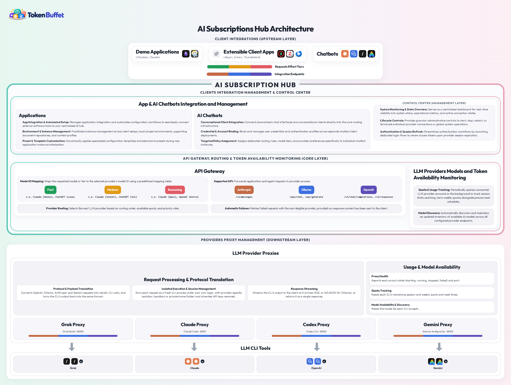

# Token Buffet: CLI LLM Proxy Router

Expose your flat-rate CLI subscriptions (Claude, Codex, Grok, agy) as a local OpenAI/Ollama/Anthropic-compatible API. Route requests by semantic tier (`fast`/`medium`/`reasoning`), smart load balance by quota, and power your downstream tools without paying per token.

## Learn the Concept

For an overview of the LLM Wiki pattern and how this fits in, watch:

**[Karpathy LLM Wiki Overview](https://www.youtube.com/watch?v=iXd0t60YmMw)**

*(Note: The video uses Claude Code as the example, but explains the LLM Wiki concepts and patterns well. Token Buffet applies the same pattern to any CLI-based LLM subscription (Claude, Codex, Grok, agy) and powers Obsidian vaults, community plugins, and agent frameworks.)*

This shows how to turn your subscriptions into a local knowledge-synthesis engine for tools like Obsidian, chatbot clients, and AI agents.

## Features
- **Small runtime:** The proxy, router, and dashboard use Python's standard HTTP server. Extractor capture needs its optional pseudo-terminal dependencies, and the Responses endpoint needs the OpenAI SDK.
- **Semantic Routing:** Translates generic model requests (`fast`, `medium`, `reasoning`) into specific provider models based on remaining usage quotas.
- **Smart Load Balancing:** Reads exported CLI quota files and routes requests to the provider with the most remaining quota.
- **True Parallelism:** Spawns sandbox directories to bypass SQLite locking limits in native CLIs.

## Architecture



## Interactive Documentation

Browse the docs as interactive maps on GitHub Pages:

- [Overview](https://jlichwa80.github.io/token-buffet/overview.html): architecture, CLI operations, client integrations, directory layout
- [Productivity Apps](https://jlichwa80.github.io/token-buffet/productivity-apps.html): everyday apps that can run on Token Buffet

## Quick Start
Token Buffet always works in the folder you run it from. Make one folder for it:

```bash
mkdir TokenBuffet && cd TokenBuffet
pip install token-buffet               # Python 3.12+; installs everything it needs
tbuffet init                           # scaffold, register the provider CLIs found on PATH, check app integrations
tbuffet demo init                      # optional: copy the demos, add them to their apps, list which can run
tbuffet start                          # proxies + router (8090) + dashboard (8080); Ctrl+C stops this session's process trees
tbuffet start --background             # explicitly leave services running in the background
tbuffet status | stop | restart | doctor
```
Log in to each vendor CLI (`claude`, `codex`, `grok`, `agy`) once. `init` doesn't check logins; a provider that isn't signed in reports its error at `tbuffet start`.

### Demos (pre-configured)
`tbuffet demo init` copies ready-to-use demos into `demo/`. Each one already points at the router, so after `tbuffet start`:
- **Obsidian LLM Wiki** (needs Obsidian installed): run `tbuffet open obsidian conference-notes` (or `daily-notes`), then choose *Trust author and enable plugins*. See [the demo README](src/tokenbuffet/default_templates/demo/Obsidian-LLM-Wiki/README.md).
- **Chatbots and Claudia:** see `demo/README.md`.

### Providers and your own apps
```bash
tbuffet add-provider claude --validate        # register a built-in provider + login/quota check
tbuffet add-provider mine --from config.json  # import a config authored with the register-provider skill
tbuffet list-providers | remove-provider NAME
tbuffet add-app obsidian my-vault --path "/path/to/vault" --vault-type daily-notes
tbuffet list-apps | reconfigure-app TYPE NAME
```

## Directory Structure
- `src/tokenbuffet/`: proxy, router, dashboard and launcher
- `src/tokenbuffet/extractors/`: provider usage and model capture/parse engine
- `src/tokenbuffet/default_templates/`: what `tbuffet init` copies into your folder:
  - `config/`
  - `integrations/` (built-in app types, and `providers/` with the built-in provider configs)
  - `scripts/`
  - `demo/` and the demo registrations in `registered_apps/` are copied by `tbuffet demo init`

In your Token Buffet folder:
- `integrations/providers/`: built-in provider configs (what Token Buffet supports)
- `registered_providers/`: the providers registered on this machine
- `data/`: runtime state (`providers_status/`, `provider_homes/`, `temp/`)
- `logs/`: proxy, router and extractor logs

## From a repository checkout
Install editable with `pip install -e .`, then run `tbuffet init` and `tbuffet start` from the repository root.

`tbuffet start` launches every provider proxy, the router (port 8090) and the dashboard (port 8080); `tbuffet stop` stops them. `tbuffet dashboard` starts the dashboard alone.

The router listens on port 8090, and the dashboard is at `http://127.0.0.1:8080/`. See the [documentation index](docs/README.md) for the bridge guides.
